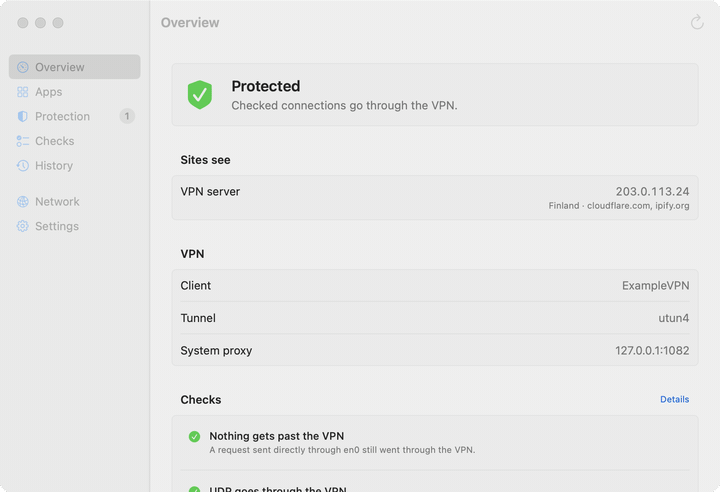
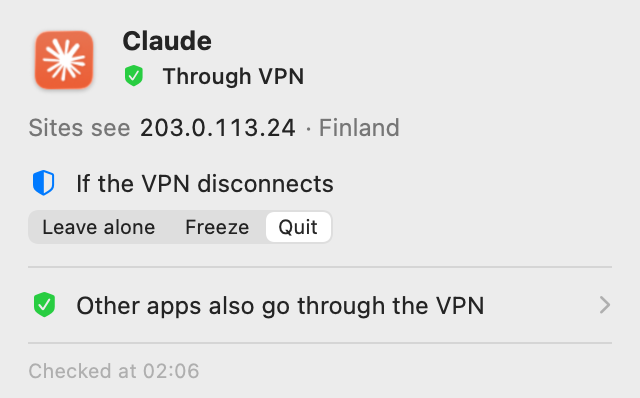
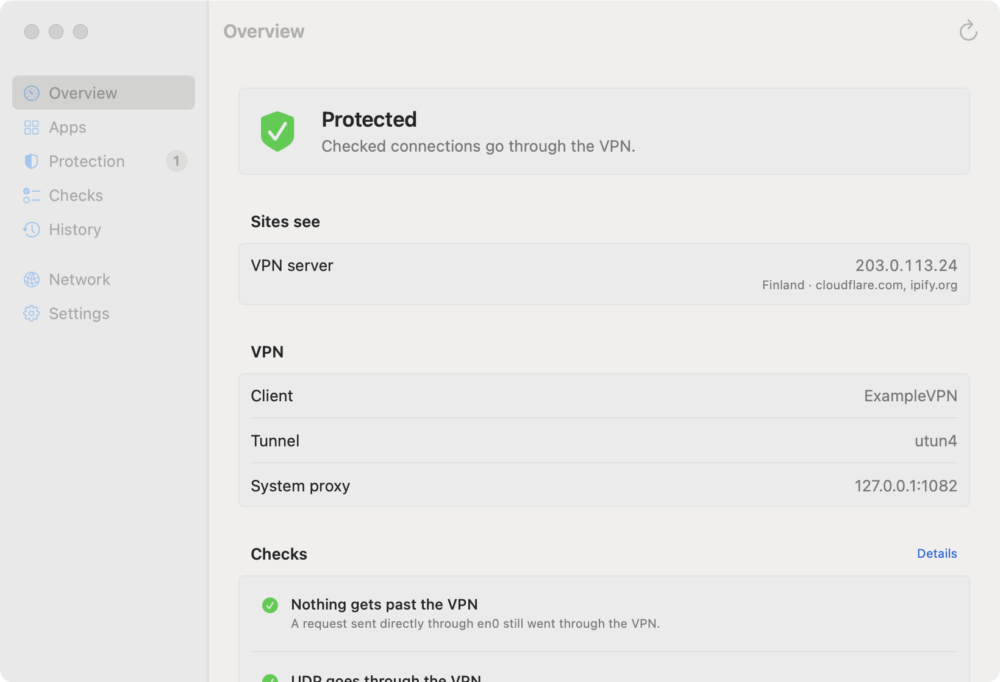

# VPN Lens

**Your VPN dropped for a second, and your apps were already online with your real address.**

VPN Lens watches the VPN and the apps you pick. The moment the VPN connection drops, it
freezes or quits those apps so they don't stay online without it. When the VPN is back and
stable, frozen apps resume on their own.

Free and open source, for macOS 14 and later. [Русский](README.md)

**[Download](https://github.com/wall-low/vpn-lens/releases/latest)** · [Website](https://wall-low.github.io/vpn-lens/en.html) · [How it works](docs/ARCHITECTURE.en.md)



## Features

- **Protection on disconnect.** Pick the apps that must never go online without the VPN,
  and whether to freeze or quit them. The choice is remembered per app, and you can set it
  right from the menu.
- **See how every app connects.** Through the VPN, around it, or partly around it, and what
  address sites see. For the active app in the menu, for all of them in the window.
- **Leak checks.** Tunnel bypass, WebRTC, IPv6 and DNS. Only what a measurement confirms is
  marked red.

> Protection fires on the system's network-change event, and the freeze itself takes
> microseconds. But it isn't a network filter: something may slip out before the event
> arrives. For added protection, also turn on your VPN client's own kill switch.

 

## Install

Requires macOS 14 or later, Apple Silicon or Intel.

With Homebrew:

```sh
brew trust --cask wall-low/tap/vpn-lens
brew install --cask wall-low/tap/vpn-lens
```

Homebrew 7 loads software from third-party taps only after `brew trust`. The command trusts
this one cask, not the whole tap. Homebrew before 7 has no such command; the second line is
enough there.

Or manually: download `VPN-Lens-*.zip` from [Releases](https://github.com/wall-low/vpn-lens/releases/latest)
and move "VPN Lens" to Applications.

**First launch.** The app is signed without an Apple Developer account and is not notarized,
so macOS blocks it. Open System Settings > Privacy & Security and click "Open Anyway" next to
VPN Lens. You only need to do this once.

After that VPN Lens lives in the menu bar. Open at login, interface language and a keyboard
shortcut are in Settings.

## How to use it

1. **The shield in the menu bar** shows the overall result: all through the VPN, at risk,
   traffic bypasses the VPN, or no VPN detected.
2. **Click the shield** for a summary of the app you're working in: whether it goes through
   the VPN, what address sites see, and what to do with it if the VPN disconnects.
3. **"Open VPN Lens..."** shows everything in detail: all apps and their connections,
   protected apps, leak checks, history, network, settings.

Notifications arrive when the VPN disconnects while apps keep working, when an app starts
bypassing the VPN, and when a check finds a leak.

## How it differs from similar tools

VPN Lens complements them rather than replacing them. Little Snitch and LuLu allow and block
connections but don't tell you whether one went through the VPN. Sites like ipleak.net only
check the browser. A VPN client's kill switch cuts the whole network but doesn't show who got
out first. VPN Lens answers a question none of them do: which app on this Mac goes through
the VPN right now, and which goes around it.

## VPN compatibility

VPN Lens isn't tied to a specific client: it looks at tunnel interfaces, the system proxy and
app connections. Verdict logic is covered by tests for several common setups: no VPN, full tunnel,
split tunnel, proxy only, domain rules. Tested live:

| Setup | Status |
|---|---|
| Tunnel plus system proxy from one client (Network Extension) | tested |
| WireGuard, OpenVPN, Tailscale | not tested yet, reports welcome |
| System proxy only, no tunnel | covered by tests, not live |

If you tried it, [let us know](https://github.com/wall-low/vpn-lens/issues/new/choose); the
"Copy Report" item in the menu helps.

## Privacy

No telemetry. Nothing about your apps or connections leaves your Mac.

To learn your external address, VPN Lens sends these requests on its own, at launch, when the
network changes, and when you open the menu if more than three minutes have passed:

| Where | Why | What the service sees |
|---|---|---|
| `cloudflare.com`, `ipify.org` | your external address, normally and through the proxy | your external address |
| `1.1.1.1` over Wi-Fi or Ethernet | whether traffic can bypass the tunnel | your address when bypassing |
| `stun.l.google.com`, `stun.cloudflare.com` | your UDP address, as WebRTC sees it | your UDP address |
| `2606:4700:4700::1111` | only if you have a public IPv6 | your IPv6 |
| `ip.nic.ru` | only if the regional site is enabled | your external address |

Only on demand: the external DNS test via `bash.ws` (the service sees your address and your
DNS servers) and the kill switch test. One switch in Settings turns off all online checks.

Stored on your Mac: settings, protected apps and provider addresses per network
(`~/Library/Preferences/io.github.wall-low.vpnlens.plist`, with a hash instead of the
router's MAC address) and the event history (`~/Library/Application Support/VPN Lens/history.json`).
To remove everything, quit VPN Lens and delete these files and the app.

## Limitations

- VPN Lens sees that an app talks to the VPN client's proxy, but not where the proxy takes it.
- Safari goes online through a shared WebKit process: VPN Lens shows it but can't protect it.
- Connections of root and other users' processes are not visible without privileges.
- Only TCP is listed; QUIC (UDP) connections are not shown yet.
- The provider's address is known only after the VPN has been off at least once on this network.

## For developers

A Rust core (sockets, checks, verdicts) and a native SwiftUI interface, connected through
UniFFI. Verdicts are pure functions of measurements, tested against setups the developer's
machine doesn't have. Details in [docs/ARCHITECTURE.en.md](docs/ARCHITECTURE.en.md).

```sh
scripts/build-app.sh --run        # build "build/VPN Lens.app" and launch it
cargo run -p vpnlens-cli          # the same core in a terminal
cargo test --workspace && swift test --package-path macos
```

How to help: [CONTRIBUTING.md](CONTRIBUTING.md). Security issues: [SECURITY.md](SECURITY.md).

## License

[MIT](LICENSE)
