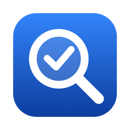
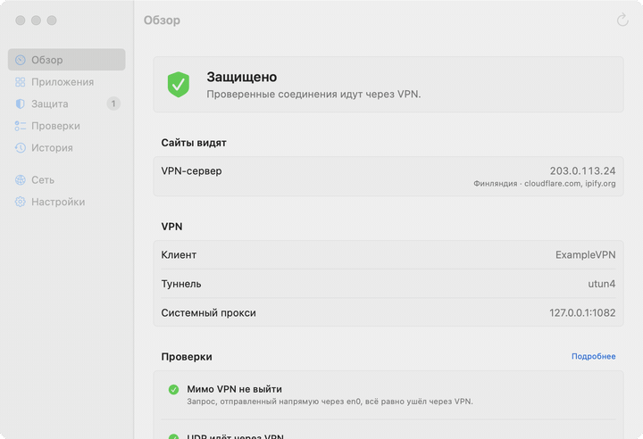
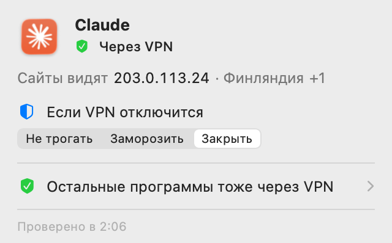
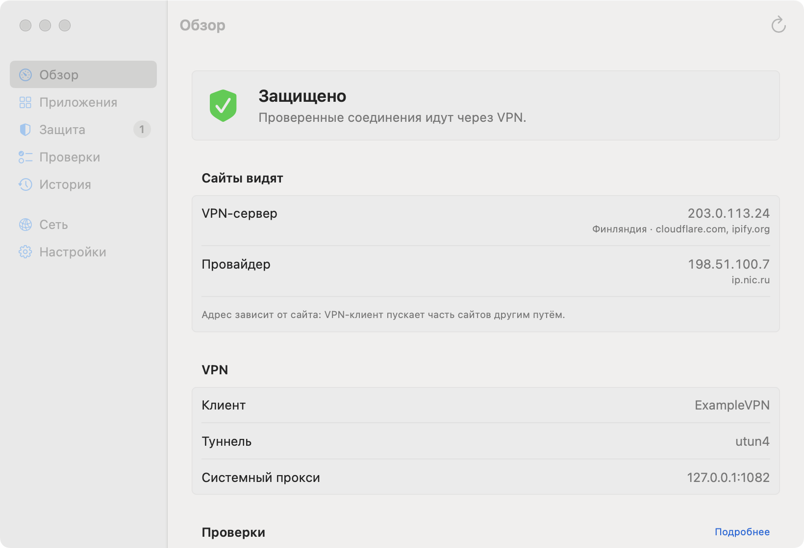

# VPN Lens

**VPN оборвался на секунду, а программы уже вышли в сеть с вашим настоящим адресом.**

VPN Lens следит за VPN и за программами, которые вы выбрали. Если соединение с VPN
пропадает, он сразу замораживает или закрывает эти программы, чтобы без VPN они не
работали в сети. Когда VPN вернётся и соединение устоится, замороженные программы
продолжат работу сами.

Бесплатно, с открытым кодом, для macOS 14 и новее. [English](README.en.md)

**[Скачать](https://github.com/wall-low/vpn-lens/releases/latest)** · [Сайт](https://wall-low.github.io/vpn-lens/) · [Как это устроено](docs/ARCHITECTURE.md)



## Что умеет

- **Защита при обрыве.** Выберите программы, которые никогда не должны выходить в сеть
  без VPN, и что с ними делать: заморозить или закрыть. Выбор запоминается для каждой
  программы, включить его можно прямо из меню.
- **Видно, кто как ходит в сеть.** Через VPN, мимо него или частично мимо, и какой адрес
  видят сайты. Для активной программы - в меню, для всех сразу - в окне.
- **Проверка утечек.** Обход туннеля, WebRTC, IPv6 и DNS. Красным помечается только то,
  что подтвердил замер.

> Защита срабатывает по системному событию об обрыве, сама заморозка занимает микросекунды.
> Но это не сетевой фильтр: пока событие доходит, что-то может успеть уйти. Для дополнительной
> защиты включите и kill switch самого VPN-клиента.

 

## Установка

Нужна macOS 14 или новее, Apple Silicon или Intel.

Через Homebrew:

```sh
brew install --cask wall-low/tap/vpn-lens
```

Или вручную: скачайте `VPN-Lens-*.zip` из [релизов](https://github.com/wall-low/vpn-lens/releases/latest)
и перенесите «VPN Lens» в «Программы».

**Первый запуск.** Приложение подписано без аккаунта Apple Developer и не нотаризовано,
поэтому macOS его заблокирует. Откройте «Системные настройки → Конфиденциальность и
безопасность» и нажмите «Открыть всё равно» напротив VPN Lens. Это нужно один раз.

Дальше VPN Lens живёт в строке меню. Запуск при входе в систему, язык интерфейса и
горячая клавиша - в настройках.

## Как пользоваться

1. **Щит в строке меню** показывает общий итог: всё через VPN, есть риск, есть трафик
   мимо VPN, VPN не обнаружен.
2. **Клик по щиту** открывает сводку по программе, с которой вы работаете: через VPN ли
   она ходит, какой адрес видят сайты, что с ней делать, если VPN отключится.
3. **«Открыть VPN Lens...»** - окно со всем подробно: все программы и их соединения,
   защищённые программы, проверки утечек, история, сеть, настройки.

Уведомления приходят, когда VPN отключился, а программы продолжили работать, когда
программа пошла мимо VPN и когда проверка нашла утечку.

## Чем отличается от похожих инструментов

VPN Lens их дополняет, а не заменяет. Little Snitch и LuLu разрешают и запрещают
соединения, но не объясняют, ушло ли оно через VPN. Сайты вроде ipleak.net проверяют
только браузер. Kill switch VPN-клиента отключает сеть целиком, но не показывает, кто
успел выйти. VPN Lens отвечает на вопрос, которого нет ни у кого из них: какая программа
на этом Mac сейчас ходит через VPN, а какая мимо.

## С какими VPN работает

VPN Lens не привязан к конкретному клиенту: он смотрит на туннельные интерфейсы,
системный прокси и соединения программ. Логика вердиктов покрыта тестами для
нескольких типовых конфигураций: без VPN, полный туннель, раздельный туннель, только прокси, правила по
доменам. Вживую проверено:

| Конфигурация | Статус |
|---|---|
| Туннель и системный прокси одного клиента (Network Extension) | проверено |
| WireGuard, OpenVPN, Tailscale | не проверено, ждём отчётов |
| Только системный прокси, без туннеля | проверено тестами, не вживую |

Если проверили у себя - [расскажите](https://github.com/wall-low/vpn-lens/issues/new/choose),
в отчёте пригодится кнопка «Скопировать отчёт» из меню.

## Приватность

Телеметрии нет. Данные о программах и соединениях не покидают Mac.

Чтобы узнать ваш внешний адрес, VPN Lens сам, при запуске, смене сети и открытии меню
(если прошло больше трёх минут), отправляет запросы:

| Куда | Зачем | Что видит сервис |
|---|---|---|
| `cloudflare.com`, `ipify.org` | внешний адрес обычным путём и через прокси | ваш внешний адрес |
| `1.1.1.1` через Wi-Fi или Ethernet | можно ли выйти мимо туннеля | ваш адрес при обходе |
| `stun.l.google.com`, `stun.cloudflare.com` | UDP-адрес, как у WebRTC | ваш UDP-адрес |
| `2606:4700:4700::1111` | только если есть публичный IPv6 | ваш IPv6 |
| `ip.nic.ru` | только если включён региональный сайт | ваш внешний адрес |

Только по кнопке: внешний DNS-тест через `bash.ws` (сервис видит ваш адрес и ваши
DNS-серверы) и проверка kill switch. Все сетевые проверки выключаются одним
переключателем в настройках.

На Mac хранятся настройки, список защищённых программ и адреса провайдеров по сетям
(`~/Library/Preferences/io.github.wall-low.vpnlens.plist`, вместо MAC-адреса роутера -
хеш) и история событий (`~/Library/Application Support/VPN Lens/history.json`). Чтобы
удалить всё, закройте VPN Lens и удалите эти файлы и само приложение.

## Ограничения

- Видно, что программа подключена к прокси VPN-клиента, но не куда прокси ведёт её дальше.
- Safari ходит в сеть через общий процесс WebKit: VPN Lens его показывает, но защитить не может.
- Соединения процессов root и других пользователей без прав не видны.
- В списке соединений только TCP, QUIC (UDP) пока не показывается.
- Адрес провайдера известен, только когда VPN хоть раз был выключен в этой сети.

## Для разработчиков

Rust-ядро (сокеты, проверки, вердикты) и нативный интерфейс на SwiftUI, связанные через
UniFFI. Вердикты - чистые функции от замеров и покрыты тестами на конфигурациях, которых
нет на машине разработчика. Подробно - в [docs/ARCHITECTURE.md](docs/ARCHITECTURE.md).

```sh
scripts/build-app.sh --run        # собрать "build/VPN Lens.app" и запустить
cargo run -p vpnlens-cli          # то же ядро в терминале
cargo test --workspace && swift test --package-path macos
```

Как помочь проекту - в [CONTRIBUTING.md](CONTRIBUTING.md), об уязвимостях - в
[SECURITY.md](SECURITY.md).

## Лицензия

[MIT](LICENSE)
